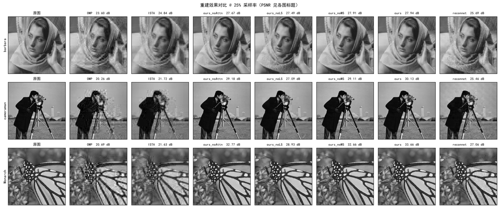

# 基于深度学习的图像压缩感知重建算法实现

> 周靖凌 · 南昌职业大学 信息技术学院 · 2027 届
>
> 从零实现图像压缩感知（Compressive Sensing, CS）的完整链路：传统基线（OMP / ISTA）→
> 基线网络（ReconNet）→ 自研网络（三级级联 + 多尺度残差 + 通道注意力），配套 Streamlit 演示系统。
> **实验数字全部由本仓库代码实际运行产生，不引用外部报告结果。**

## 结果速览

Set11 测试集，256×256，25% 采样率（11 张平均）：

| 方法 | PSNR (dB) | SSIM | 单图耗时 |
|---|---|---|---|
| OMP | 22.54 | 0.6038 | — |
| ISTA（FISTA 加速） | 23.72 | 0.6716 | ~0.46 s |
| ReconNet | 27.39 | 0.8213 | — |
| **Ours** | **32.47** | **0.9346** | **~0.05 s** |

三档采样率（10% / 25% / 50%）分别为 **27.60 / 32.47 / 36.34 dB**。
消融实验显示可学习采样贡献最大（+3.16 dB），说明低采样率下的瓶颈在**测量端**而非重建端。



---

## 1. 目录结构

```
code/
├── README.md              本文件（口径与用法，先读这个）
├── requirements.txt       依赖清单（实际安装版本）
├── src/
│   ├── metrics.py         PSNR / SSIM
│   ├── classical/         传统方法
│   │   ├── sampling.py    分块压缩采样（测量矩阵 Φ）
│   │   ├── sparse.py      DCT 稀疏基 Ψ
│   │   ├── omp.py         正交匹配追踪（OMP）
│   │   └── ista.py        迭代软阈值（ISTA）
│   ├── data/
│   │   ├── prepare.py     图像读取 / 分块 / 尺寸处理
│   │   └── dataset.py     PyTorch Dataset 与测试集加载
│   └── models/            深度学习模型（阶段 2/3 填充）
├── scripts/
│   ├── download_data.py   数据集下载（含国内网络源说明）
│   └── smoke_test.py      环境与链路冒烟测试
├── configs/               实验配置
├── data/                  数据集（不纳入版本管理）
└── results/               实验结果输出
```

## 2. 环境安装

要求：Windows + NVIDIA GPU（本项目开发机为 RTX 3060 Laptop 6GB，驱动 591.74）。
PyTorch 需要 Windows 下 Python 3.10–3.14。

```bash
# 1) 创建虚拟环境（Python 3.12）
uv venv .venv --python 3.12

# 2) 安装 PyTorch（GPU 版，CUDA 13.0 —— 按本机驱动选择，命令以官网为准）
.venv/Scripts/python.exe -m pip install torch torchvision \
    --index-url https://download.pytorch.org/whl/cu130
# 官方源实测可达且速度快；若网络受限，可换镜像后重试

# 3) 安装其余依赖
.venv/Scripts/python.exe -m pip install numpy scipy scikit-image matplotlib tqdm pyyaml plotly
```

验证环境：`.venv/Scripts/python.exe scripts/smoke_test.py`

### 用 Visual Studio Code 打开（推荐）

项目内置了 `.vscode/` 配置（解释器、调试、任务都已配好），用 VS Code 打开
**`D:\毕业设计\code` 这个文件夹**即可（不是打开某个 .py 文件）：

```bash
cd D:\毕业设计\code
code .            # code 已在 PATH 中；或右键文件夹 →「通过 Code 打开」
```

| 想做什么 | 怎么操作 | 说明 |
|---|---|---|
| 启动演示系统 | `Ctrl+Shift+B` | 集成终端里跑 streamlit，改 `app.py` / `src/*.py` 自动重载 |
| 调试演示系统 | `F5` → 选「调试演示系统（Streamlit）」| 可下断点单步调试 |
| 跑冒烟测试 | `Ctrl+Shift+P` → Tasks: Run Test Task | 论文 5.4 的自动化测试证据（6 场景 12 项）|
| 生成论文折线图 | `Ctrl+Shift+P` → Tasks: Run Task → 生成论文折线图 | 输出 `results/figures/*.png` |
| 生成对比总表/对比图 | 同上 | 输出 `results/comparison_set11.md` 与对比图 |

解释器已在 `settings.json` 里指向 `.venv\Scripts\python.exe`，不会弹「选择解释器」；
`.vscode/` 已在 `.gitignore` 中，不影响仓库。

## 3. 数据准备

```bash
python scripts/download_data.py --all        # 一次性下载（约 5 分钟）
python scripts/download_data.py --check      # 只检查
```

| 数据集 | 用途 | 划分 | 来源 |
|---|---|---|---|
| BSDS500 | 训练 | **train 200 + val 100 = 300 张** | BIDS/BSDS500 镜像（经 jsDelivr CDN 并行下载）|
| Set11 | 测试 | 11 张经典灰度图 | ISTA-Net 官方仓库（jsDelivr CDN）|

> 国内网络实测（2026-10）：伯克利官网直连约 8 KB/s（勿用）；GitHub git clone 不稳定
> （多次 `invalid index-pack output` 中断）；**jsDelivr CDN 是唯一稳定可达的源**，
> 多线程并行后约 4 分钟下完 300 张。BSDS500 图片下载由 `scripts/fetch_bsds500_cdn.py` 独立完成。

## 4. 实验口径（重要，写论文时必须一致）

以下约定是全项目基准，任何对比实验都必须使用同一套口径；与文献数字对比时先核对对方口径。

| 项 | 约定 |
|---|---|
| 图像处理 | 灰度图，范围 [0,1] |
| 块尺寸 | **33×33（不重叠）**，与 ReconNet / ISTA-Net 等一致 |
| 块向量 | N = 1089 维，`x ∈ R^1089` |
| 采样率 rate | **M / 1089**，M = round(rate × 1089)；三档：0.10 / 0.25 / 0.50 |
| 测量矩阵 Φ | 高斯随机矩阵，**按行归一化**（每行 L2 范数 = 1），固定种子可复现 |
| 采样方式 | 逐块独立：y = Φx，y ∈ R^M |
| 稀疏基 Ψ | 33×33 二维 DCT（正交），`Psi = kron(D, D)` |
| 训练集 | BSDS500 train+val（300 张）全部不重叠块，共约 3.7 万块 |
| 测试口径 | Set11 图 **resize 256×256 → edge padding 至 264×264 → 采样重建 → 裁回 256×256 计算指标** |
| PSNR | `10·log10(MAX²/MSE)`，MAX = 1.0（[0,1] 域口径）|
| SSIM | 11×11 高斯窗 σ=1.5（Wang et al. 2004 口径）|
| 随机种子 | 采样矩阵 seed=0；训练固定 torch 种子（各实验脚本注明）|

> 与文献对比注意：部分论文测试结算在 231×231 裁剪区域或不做 padding，PSNR 会有 ±0.1~0.3 dB 级差异。
> 论文中报告数字时**必须写明本次口径**（表格下方加注），不得直接混用不同口径的数字。

## 5. 快速开始

```bash
# 冒烟测试：验证环境 → 采样 → 重建 → 指标全链路（用合成图）
python scripts/smoke_test.py

# 用 Set11 真实图像验证
python scripts/smoke_test.py --real

# 阶段 1 基线实验：Set11 × 三档采样率 × OMP / ISTA-FISTA（全量约 4 分钟）
python scripts/run_baseline.py            # 全量（11 张图）
python scripts/run_baseline.py --quick    # 快速验证（3 张图、仅 0.25）
# 产出（results/ 目录）：
#   baseline_set11.csv     逐图逐档原始数据（含耗时，论文表格数据源）
#   baseline_set11.md      论文用对比表（PSNR / SSIM）
#   baseline_visual.png    重建效果对比图（带 PSNR 标注）
#   baseline_config.json   实验配置快照（含超参，保证可复现）

# 传统基线重建（示例：OMP 在 0.25 采样率下重建一张图）
python -c "
import torch, numpy as np
from src.data.dataset import load_set11
from src.data.prepare import pad_to_multiple
from src.classical.omp import omp_reconstruct
from src.metrics import evaluate

name, img = load_set11('data/Set11')[0]
x = torch.from_numpy(pad_to_multiple(img))[None, None]
device = 'cuda' if torch.cuda.is_available() else 'cpu'
rec = omp_reconstruct(x, rate=0.25, device=device)[:, :, :256, :256]
print(name, evaluate(rec.cpu(), torch.from_numpy(img)[None, None]))
"
```

**传统算法超参（经预实验确定）**：OMP 稀疏度 `max(15, M//8)`；
ISTA 用 FISTA 加速、lam=0.01、1000 次迭代。超参扫描记录见
`results/baseline_config.json`。

### 阶段 2/3：深度学习模型训练与评估

```bash
# 训练（三档采样率各自一个模型；单档约 15 分钟@单进程）
python -m src.train --model reconnet --rate 0.10 --epochs 100
python -m src.train --model reconnet --rate 0.25 --epochs 100
python -m src.train --model reconnet --rate 0.50 --epochs 100
# 快速验证：加 --epochs 5

# 自研网络（三级级联 + 多尺度残差 + 注意力，可学习采样）
python -m src.train --model ours --rate 0.25 --epochs 100

# 消融实验（每个开关对应一个变体，checkpoint 自动带后缀）
python -m src.train --model ours --rate 0.25 --epochs 100 --no-learnable-sampling  # ours_noLS
python -m src.train --model ours --rate 0.25 --epochs 100 --no-multiscale          # ours_noMS
python -m src.train --model ours --rate 0.25 --epochs 100 --no-attention           # ours_noAttn

# 评估（Set11 全量，输出汇总表 + 效果图到 results/）
python scripts/eval_model.py --model reconnet              # 三档
python scripts/eval_model.py --model ours --rates 0.25
python scripts/eval_model.py --model ours_noAttn --rates 0.25   # 消融变体

# 统一对比总表 + 对比图（自动发现 results/ 下所有方法）
python scripts/make_comparison.py
python scripts/make_comparison.py --visual-rate 0.25 --images barbara cameraman Monarch
```

产物：`checkpoints/<run_name>_r<档位>.pth`（含配置与结构参数）、
`results/train_*_log.csv`（逐 epoch loss）、
`results/deep_<model>_set11.{csv,md}`、`results/deep_<model>_visual.png`、
`results/comparison_set11.md`、`results/comparison_visual.png`。

**模型接口约定**：`samples_internally` 类属性区分两类模型——
ReconNet=False（外部固定 Φ 采样）、OursNet=True（采样为网络的一部分，可学习）。
训练/评估脚本按此自动分支。

**训练公平性约定**：固定 Φ 模型使用测量矩阵 seed=0（与评估/传统方法一致）；
不使用测试集做模型选择；固定 epoch 训练后报告最终模型。

### 演示系统（4.3，答辩演示用）

```bash
# 启动（浏览器自动打开 http://127.0.0.1:8501）
.venv\Scripts\streamlit.exe run app.py
```

也可以直接双击项目里的 `start_demo.cmd`：它会保留控制台日志、检测 8501 端口是否被占用，
并以 `--server.runOnSave true` 启动（改动 `app.py` 或 `src/*.py` 后页面自动重载，
不会再出现"改了代码刷新的还是旧页面"）。出错时窗口不会自动关闭，便于排查。

功能：图像上传 / 内置 Set11 示例图 → 采样率选择（10% / 25% / 50% / 三档全对比）
→ 三级级联网络重建 → PSNR / SSIM / 耗时展示；含 OMP/ISTA 传统方法对照、
可学习测量核可视化（答辩加分项）。

**模型对比折线图**（Plotly 交互图，见 `src/plotting.py`，数据取自 `results/` 下已跑完的
评估结果，不额外推理）：

| 分页 | 内容 | 数据来源 |
|---|---|---|
| ① 指标–采样率 | 各方法 PSNR / SSIM 随采样率变化的折线 | `results/*_set11.csv` 逐图平均 |
| ② 逐图像对比 | 同一档采样率下、11 张测试图的逐图指标折线 | 同上（可切档、可切指标）|
| ③ 消融实验 | 依次移除各模块后的性能落差折线（含对比方法参考线）| `deep_ours_no*_set11.csv` |
| ④ 训练收敛 | loss–epoch 折线（对数轴，自动隐藏发散异常点）| `results/train_*_log.csv` |
| ⑤ 本图实测 | 当前演示图像在三档采样率下的实测折线（与页面结果同源）| 页面实时推理 |

自动化测试（论文 5.4 系统测试证据）：
`python scripts/app_smoke_test.py`（6 场景 12 项检查，全部通过）。

**论文插图（第 5 章折线图）**：
```bash
.venv/Scripts/python.exe scripts/make_line_figures.py
```
产出 `results/figures/`：

| 文件 | 用途 | 已插入论文位置 |
|---|---|---|
| `fig5_rate_curve.png` | 各方法 PSNR / SSIM 随采样率变化曲线（双子图）| 图5-1（5.2 节，表5-2 之后）|
| `fig5_per_image.png` | 25% 采样率下 11 张测试图的逐图 PSNR 对比 | 图5-5（5.3 节）|

数据同样取自 `results/` 下已跑完的评估结果，与演示系统折线图、论文表格三处同源。

## 6. 完成情况

| 阶段 | 内容 | 状态 |
|---|---|---|
| 0 | 环境 + 数据 + 链路 | ✅ 完成 |
| 1 | OMP / ISTA 基线复现，三档采样率出表 | ✅ 完成 |
| 2 | ReconNet 复现（深度学习基线）| ✅ 完成 |
| 3 | 自研网络：三级级联 + 多尺度残差 + 注意力 | ✅ 完成 |
| 4 | 训练调优（100 epoch + 10 epoch 精调）| ✅ 完成 |
| 5 | 对比实验 + 消融实验 + 演示系统 | ✅ 完成 |
| 6 | 论文实验章节整理 | ✅ 完成 |

产物：`results/comparison_set11.md`（对比总表）、`results/ablation_set11.md`（消融）、
`results/figures/`（论文插图）、`checkpoints/`（三档权重，未纳入版本管理）。

## 7. 国内网络与缓存配置（重要，2026-10 实测）

本机为国内家庭宽带环境，实测结论（避免重复踩坑）：

| 源 | 实测情况 | 结论 |
|---|---|---|
| download.pytorch.org（官方）| 单连接 ~150 KB/s，多连接 ~1-7 MB/s | 可用但需耐心，uv 多连接模式较快 |
| 伯克利 BSDS500 官网 | ~8 KB/s | **不可用**，勿尝试 |
| raw.githubusercontent.com | 连接超时 | **不可达** |
| github.com / codeload | git clone 多次 `invalid index-pack output` | 不稳定 |
| **jsDelivr CDN** | 稳定，多线程后 ~1 MB/s | **BSDS500 / Set11 首选源** |

**缓存与临时文件一律不写 C 盘**（C 盘空间紧张），已做配置：

```
UV_CACHE_DIR = F:\bj_cache\uv      （用户环境变量，永久生效）
PIP_CACHE_DIR = F:\bj_cache\pip    （用户环境变量，永久生效）
```

- uv 首次安装 torch 曾在 C 盘 cache 目录触发 `rename ... 拒绝访问 (os error 5)`
  失败（疑似杀毒软件/文件锁干扰）；换到 F 盘后重试。
- pip 下载大包时先把文件写到系统 Temp（C 盘），必要时通过
  `TEMP/TMP` 环境变量临时重定向：`TEMP=F:/bj_cache/tmp pip install ...`
- 删除大文件时本机环境会走"安全删除"进回收站，空间不会立即释放，
  需清空回收站才真正回收。

## 8. 常见问题

- **`torch.cuda.is_available()` 为 False**：确认装的是 cu 版本（版本号带 `+cu130` 后缀），
  用 `python -c "import torch; print(torch.__version__)"` 检查。
- **显存不足（OOM）**：6GB 显存建议 batch size 16–32、开启混合精度（AMP）。
- **下载慢/失败**：见第 3 节数据源说明；脚本内置多镜像回退。
- **数值复现**：所有随机过程（测量矩阵、训练打乱、增强）均固定种子；
  跨设备复现时保留数据划分与评估口径不变即可。
